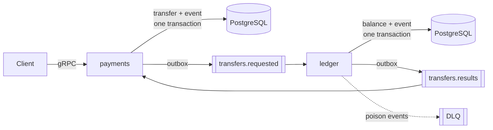

# Aqsha — payment microservices in Go: gRPC, Kafka, Kubernetes

[](https://github.com/A160LKN/aqsha/actions/workflows/ci.yml)

[Русский](README.md) · **English**

Two services move money between accounts through Kafka. The point of the project is the test suite proving that a transfer happens **exactly once**: under redelivered events, a service crashing mid-processing, Kafka being down and concurrent requests. _Aqsha_ means "money" in Kazakh.

**Stack:** Go 1.27, gRPC + protobuf (buf), Apache Kafka (franz-go), PostgreSQL (pgx), Prometheus, Grafana, Docker, Kubernetes · **Tests:** Go + Testify, kfake, bufconn, k6 · **CI:** GitHub Actions, GitLab CI



## How it works

- **payments** accepts a transfer over gRPC and answers `PENDING` right away. The transfer and its event are written in one transaction (**transactional outbox**); a separate loop publishes the event to Kafka. "Saved but the event was lost" cannot happen.
- **ledger** applies the transfer: locks both accounts in id order (opposite transfers never deadlock), checks the balance, writes ledger entries. The event id is stored in the same transaction, so **a redelivered event changes nothing**.
- The outcome comes back as an event; payments only moves a status out of `pending`, so a late duplicate cannot overwrite the result.
- The message key is the debited account: transfers from one account land in one partition and are processed in order.
- A malformed event goes to a **DLQ** with the reason; a transient error (database down) is retried with growing backoff.
- **Idempotency key**: a client retrying after a dropped connection gets the same transfer; the same key with a different amount is `ALREADY_EXISTS`.
- Every request has a `trace_id`: returned to the client, written to JSON logs and carried in Kafka headers, so the whole path of a transfer through both services can be traced.

## Tests

| Level | What they check |
| --- | --- |
| Contracts | `buf lint`; **`buf breaking`** — a `.proto` change cannot break existing clients; generated code matches the contract |
| Unit | boundary amounts, all 9 status transitions, key parsing |
| Integration | gRPC over bufconn on PostgreSQL and in-memory Kafka (kfake): error codes and auth; **an event delivered three times charges once**; **crash before the offset commit**; **50 parallel debits with money for 20**; **100 opposite transfers without deadlock**; poison events go to the DLQ; Kafka down — events wait in the outbox; two replicas never publish an event twice; migrations on concurrent start |
| System | both services in one process: ledger down while clients transfer money; restart in the middle of 50 transfers |
| E2E | real Kafka and PostgreSQL in **Docker Compose** and **Kubernetes (kind)**; a **chaos test** stops the ledger mid-flow (`docker compose stop`, `kubectl scale --replicas=0`) |
| Load | **k6 over gRPC**: p95 and p99, then a check that the sum of all balances is unchanged |

54 tests (more with subtests) + 6 E2E. Security: an API key on both services (an account belongs to its client; other clients' accounts are invisible), a NetworkPolicy in Kubernetes, govulncheck and CodeQL in every CI run, gRPC server limits, policy in [SECURITY.md](SECURITY.md). Service code coverage is about 83 %, CI fails below 80 %. Load: **250–260 transfers per second, p95 in single-digit milliseconds** (CI runs; details in the [test report](docs/testing/protocol.md), in Russian), balances reconcile to the tiyn.

### What the tests found

| Where | What was wrong | Found by |
| --- | --- | --- |
| Migrations | the service started without tables: migration files sat in a nested folder of the embedded file system, the lookup found none and silently reported success — every request would have returned `500` | ledger integration tests · [root cause analysis](docs/testing/rca-bug-01.md) |
| Chaos test in Kubernetes | when restarting `kubectl port-forward`, `pkill -f` matched and killed its own shell — the test failed for a reason unrelated to the service; the process is now stopped by a PID file | first CI run in kind |

Test documentation (in Russian): [test strategy](docs/testing/test-strategy.md) · [test programme and methodology per GOST 19.301](docs/testing/pmi.md) · [test report](docs/testing/protocol.md) · [defect root cause analysis](docs/testing/rca-bug-01.md)

## Running locally

Requires Docker.

```bash
docker compose up --build --wait                          # PostgreSQL, Kafka, both services
docker compose --profile observability up --wait          # plus Prometheus and Grafana: http://localhost:3000
```

Tests:

```bash
go test -race ./internal/...              # needs PostgreSQL: TEST_DATABASE_URL, default localhost:5432, aqsha/aqsha
go test -tags e2e ./e2e                   # against the running system
k6 run load/transfers.js                  # load test
```

Without Docker: `go run ./cmd/devkafka` starts an in-memory Kafka on port 9092 that both services use like the real one.

## CI

1. **Contracts** — buf lint and format, buf breaking against `main`, generated code matches `.proto`, gofmt, go vet.
2. **Tests** — every level on PostgreSQL with `-race` and a coverage threshold.
3. **E2E** — Docker Compose with Kafka 3.9: E2E, chaos test, k6 load.
4. **Kubernetes** — the image is loaded into a kind cluster, deployed with kustomize, E2E and chaos test in the cluster.

The same pipeline for GitLab — [`.gitlab-ci.yml`](.gitlab-ci.yml).
