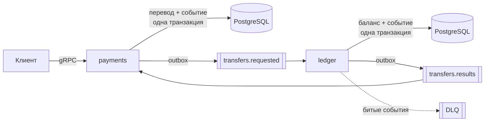

# Aqsha — платёжные микросервисы на Go: gRPC, Kafka, Kubernetes

[](https://github.com/A160LKN/aqsha/actions/workflows/ci.yml)

**Русский** · [English](README.en.md)

Два сервиса переводят деньги между счетами через Kafka. Главное в проекте — тесты, которые доказывают, что перевод проходит **ровно один раз**: при повторной доставке события, падении сервиса посреди обработки, недоступной Kafka и одновременных запросах. _Ақша_ по-казахски — «деньги».

**Стек:** Go 1.27, gRPC + protobuf (buf), Apache Kafka (franz-go), PostgreSQL (pgx), Prometheus, Grafana, Docker, Kubernetes · **Тесты:** Go + Testify, kfake, bufconn, k6 · **CI:** GitHub Actions, GitLab CI



## Как это устроено

- **payments** принимает перевод по gRPC и сразу отвечает `PENDING`. Перевод и событие о нём пишутся в одной транзакции (**transactional outbox**), отдельный цикл отправляет событие в Kafka. Так не бывает «перевод сохранён, а событие потерялось».
- **ledger** проводит перевод: блокирует оба счёта в порядке id (встречные переводы не уходят в deadlock), проверяет баланс, пишет проводки. Идентификатор события сохраняется в той же транзакции, поэтому **повторная доставка ничего не меняет**.
- Итог возвращается событием, payments меняет статус только из `pending` — опоздавший дубль не перезапишет результат.
- Ключ сообщения — счёт списания: переводы с одного счёта попадают в одну партицию и обрабатываются по порядку.
- Битое событие уходит в **DLQ** с причиной, временная ошибка (недоступна база) — повтор с растущей паузой.
- **Ключ идемпотентности**: клиент повторил запрос после обрыва — получает тот же перевод; тот же ключ с другой суммой — `ALREADY_EXISTS`.
- У каждого запроса есть `trace_id`: он возвращается клиенту, пишется в JSON-логи и идёт в заголовках Kafka — по нему видна вся цепочка перевода через оба сервиса.

## Тесты

| Уровень | Что проверяют |
| --- | --- |
| Контракты | `buf lint`; **`buf breaking`** — изменение `.proto` не ломает старых клиентов; сгенерированный код совпадает с контрактом |
| Юнит | граничные суммы, все 9 переходов статуса, разбор ключей |
| Интеграционные | gRPC через bufconn на PostgreSQL и Kafka в памяти (kfake): коды ошибок и авторизация; **трёхкратная доставка — одно списание**; **падение до фиксации смещения**; **50 параллельных списаний при деньгах на 20**; **100 встречных переводов без deadlock**; битые события — в DLQ; Kafka недоступна — события ждут в outbox; две реплики не отправляют событие дважды; миграции при одновременном старте |
| Системные | оба сервиса в одном процессе: сервис счетов лежит, пока клиенты переводят деньги; перезапуск посреди потока из 50 переводов |
| E2E | настоящие Kafka и PostgreSQL в **Docker Compose** и в **Kubernetes (kind)**; **хаос-тест** — сервис счетов останавливается посреди переводов (`docker compose stop`, `kubectl scale --replicas=0`) |
| Нагрузка | **k6 по gRPC**: p95 и p99, а после нагрузки — сверка суммы всех балансов |

54 теста (с подтестами больше) + 6 E2E. Безопасность: ключ API у обоих сервисов (счёт принадлежит клиенту, чужой — не виден), NetworkPolicy в Kubernetes, govulncheck и CodeQL в каждом CI, пределы gRPC-сервера, политика — в [SECURITY.md](SECURITY.md). Покрытие кода сервисов — 83,7 %, CI падает ниже 80 %. Нагрузка: **262 перевода в секунду, p95 — 3,2 мс** (последний прогон в CI), деньги сошлись до тиына.

### Что нашли тесты

| Где | Что было | Кто нашёл |
| --- | --- | --- |
| Миграции | сервис стартовал без таблиц: файлы миграций лежали во вложенной папке встроенной файловой системы, поиск их не находил и молча возвращал успех — каждый запрос получал бы `500` | интеграционные тесты сервиса счетов · [разбор](docs/testing/rca-bug-01.md) |
| Хаос-тест в Kubernetes | при перезапуске `kubectl port-forward` команда `pkill -f` находила и завершала собственную оболочку — тест падал не из-за сервиса; теперь процесс останавливается по PID-файлу | первый прогон CI в kind |

Документация: [тест-стратегия](docs/testing/test-strategy.md) · [программа и методика испытаний по ГОСТ 19.301](docs/testing/pmi.md) · [протокол испытаний](docs/testing/protocol.md) · [разбор дефекта](docs/testing/rca-bug-01.md)

## Запуск

Нужен Docker.

```bash
docker compose up --build --wait                          # PostgreSQL, Kafka, оба сервиса
docker compose --profile observability up --wait          # плюс Prometheus и Grafana: http://localhost:3000
```

Попробовать через [grpcurl](https://github.com/fullstorydev/grpcurl) — у сервисов включён reflection.
Оба сервиса требуют ключ `x-api-key` (переменная `API_KEYS`). Счёт принадлежит клиенту, который его открыл:
чужой счёт нельзя прочитать, пополнить или списать с него деньги — для клиента его просто нет.

```bash
grpcurl -plaintext -H 'x-api-key: demo-key-change-me' -d '{"owner":"Алия"}' localhost:9091 aqsha.ledger.v1.LedgerService/OpenAccount
grpcurl -plaintext -H 'x-api-key: demo-key-change-me' \
  -d '{"account_id":"acc_…","amount_tiyn":1000000,"deposit_id":"d1"}' localhost:9091 aqsha.ledger.v1.LedgerService/Deposit
grpcurl -plaintext -H 'x-api-key: demo-key-change-me' \
  -d '{"idempotency_key":"order-0001","from_account":"acc_…","to_account":"acc_…","amount_tiyn":250000}' \
  localhost:9090 aqsha.payments.v1.PaymentService/CreateTransfer
```

Тесты:

```bash
go test -race ./internal/...              # нужен PostgreSQL: TEST_DATABASE_URL, по умолчанию localhost:5432, aqsha/aqsha
go test -tags e2e ./e2e                   # против запущенной системы
k6 run load/transfers.js                  # нагрузка
```

Без Docker: `go run ./cmd/devkafka` поднимает Kafka в памяти на порту 9092 — оба сервиса работают с ней как с настоящей.

## Структура

```
proto/            контракты gRPC и событий Kafka (buf)
gen/              сгенерированный код
cmd/              точки входа: ledger, payments, devkafka
internal/
├── payments/     API переводов, ключи клиентов, приём итогов
├── ledger/       счета, пополнения, проведение переводов из Kafka
├── outbox/       transactional outbox
├── platform/     база и миграции, Kafka, логи, метрики, gRPC-сервер
├── system/       системные тесты: оба сервиса вместе
└── testutil/     своя база на тест, Kafka в памяти, gRPC через bufconn
e2e/              E2E и хаос-тест против развёрнутой системы
load/             нагрузочный тест k6
deploy/           Kubernetes (kustomize), Prometheus, Grafana
docs/testing/     тест-стратегия, ПМИ, протокол, разбор дефекта
```

## CI

1. **Контракты** — buf lint и format, buf breaking против `main`, сгенерированный код совпадает с `.proto`, gofmt, go vet.
2. **Тесты** — все уровни на PostgreSQL с `-race` и порогом покрытия.
3. **E2E** — Docker Compose с Kafka 3.9: E2E, хаос-тест, нагрузка k6.
4. **Kubernetes** — образ загружается в кластер kind, развёртывание через kustomize, E2E и хаос-тест в кластере.

Тот же конвейер для GitLab — [`.gitlab-ci.yml`](.gitlab-ci.yml).
