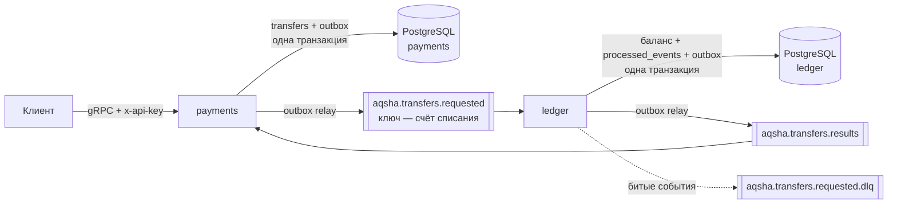

# Тест-стратегия Aqsha

## Цель

Доказать, что перевод денег между сервисами, связанными очередью, проходит **ровно один раз** при любых сбоях: повторной доставке события, падении сервиса посреди обработки, недоступности Kafka или базы, одновременных запросах. Ошибка здесь — это двойное списание или потерянные деньги, поэтому проверок больше всего на границах между сервисами, а не внутри функций.

## Архитектура, которую тестируем

Доставка в Kafka — «хотя бы один раз». Значит, дубль события — не авария, а штатная ситуация, и каждый получатель обязан быть идемпотентным.

## Анализ рисков

| Риск | Вероятность | Влияние | Как снижаем |
| --- | --- | --- | --- |
| Повторная доставка события списала деньги дважды | высокая | критичное | `processed_events` в той же транзакции, что и движение денег; тесты дубля, падения до фиксации смещения, перезапуска посреди потока |
| Клиент повторил запрос (обрыв сети) — создан второй перевод | высокая | критичное | ключ идемпотентности с уникальным индексом; тест 20 одновременных повторов; повтор с другой суммой — `AlreadyExists` |
| Изменение сохранено, а событие не ушло (или наоборот) | средняя | критичное | transactional outbox; тесты отката транзакции и недоступной Kafka |
| Счёт ушёл в минус при одновременных списаниях | средняя | критичное | `SELECT … FOR UPDATE` + `CHECK (balance >= 0)`; тест 50 параллельных списаний при деньгах на 20 |
| Встречные переводы A→B и B→A — deadlock | средняя | высокое | блокировка счетов в порядке id; тест 100 встречных переводов |
| Битое событие блокирует очередь навсегда | средняя | высокое | ошибка-«яд» уходит в DLQ, временные ошибки повторяются с паузой; тесты обоих случаев |
| Опоздавший итог перезаписал итоговый статус | низкая | высокое | переход только из `pending`; таблица всех 9 переходов |
| Изменение `.proto` сломало старых клиентов | средняя | высокое | `buf breaking` в CI против `main`; проверка, что сгенерированный код совпадает с контрактом |
| Посторонний читает чужие переводы | низкая | высокое | ключ клиента в каждом запросе; чужой перевод — `NotFound`; сравнение ключей за постоянное время |
| Сервис не стартует или стартует без схемы | низкая | высокое | миграции с advisory-lock; ошибка, если файлов миграций нет (дефект BUG-01) |
| Под нагрузкой деньги «расходятся» | низкая | критичное | k6 после нагрузки сверяет сумму всех балансов |

## Уровни тестирования

| Уровень | Что проверяем | Чем | Где |
| --- | --- | --- | --- |
| Статический анализ | форматирование, `go vet`, стиль и совместимость `.proto` | gofmt, go vet, buf lint, buf breaking | CI, каждый коммит |
| Юнит | суммы, статусы, разбор ключей, идентификаторы | Go + Testify, табличные тесты | без внешних зависимостей |
| Интеграционные | gRPC-API, обработчики событий, outbox, миграции | Go + Testify, gRPC через bufconn, PostgreSQL, Kafka в памяти (kfake) | своя база на каждый тест, тесты идут параллельно |
| Системные | оба сервиса вместе в одном процессе, остановка и перезапуск сервиса счетов | то же | — |
| E2E | развёрнутая система снаружи, как клиент | Go + gRPC, настоящие Kafka и PostgreSQL | Docker Compose и Kubernetes (kind) в CI |
| Хаос | остановка сервиса счетов посреди переводов | `docker compose stop` / `kubectl scale --replicas=0` из E2E-теста | CI |
| Нагрузка | время ответа и целостность денег под нагрузкой | k6 по gRPC | CI |

**Почему Kafka в памяти, а не Testcontainers.** kfake реализует протокол Kafka (группы потребителей, смещения, партиции) и стартует за миллисекунды, поэтому интеграционные тесты не требуют Docker и идут параллельно. Расхождения kfake с настоящей Kafka ловят E2E-тесты: они идут на образе `apache/kafka`.

## Окружения

| Окружение | Состав | Назначение |
| --- | --- | --- |
| Локально без Docker | PostgreSQL + `go run ./cmd/devkafka` | разработка, все тесты, кроме E2E на настоящей Kafka |
| Docker Compose | PostgreSQL 17, Kafka 3.9 (KRaft), оба сервиса; по профилю — Prometheus и Grafana | E2E, хаос-тест, нагрузка |
| Kubernetes (kind) | те же компоненты как Deployment и Service, gRPC-пробы готовности | проверка манифестов, E2E в кластере |

## Тестовые данные

- Каждый интеграционный тест создаёт свою базу и удаляет её после себя — тесты независимы.
- Счета и суммы создаются в самом тесте, в тиынах; граничные значения: 0, 1 тиын, весь баланс, баланс + 1 тиын, потолок 1 млрд ₸ и потолок + 1.
- Нагрузка: 20 счетов по 1 млн ₸, случайные переводы между ними; инвариант — сумма балансов не меняется.

## Критерии

**Начало:** сборка проходит `go vet`, `.proto` проходят `buf lint`.

**Готовность к релизу:**
- все тесты зелёные на всех уровнях, покрытие кода сервисов не ниже 80 %;
- `buf breaking` не нашёл несовместимых изменений;
- хаос-тест: после остановки и запуска сервиса счетов все переводы завершены ровно один раз;
- нагрузка: p95 `CreateTransfer` < 300 мс, ошибок < 1 %, сумма балансов сошлась;
- нет открытых дефектов Critical и Major.

## Классификация дефектов

| Критичность | Пример |
| --- | --- |
| Critical | двойное списание, потерянный перевод, отрицательный баланс |
| Major | перевод зависает в `pending`, сервис не стартует, контракт сломан для старых клиентов |
| Minor | неверный код ошибки gRPC, неточный текст ошибки |
| Trivial | опечатка в логе или описании |

## Что не тестируется и почему

- Несколько брокеров Kafka и потеря брокера — в стенде один брокер; поведение клиента при `acks=all` описано, но не проверено отказом брокера.
- Шифрование трафика (TLS) — в стенде выключено.
- Долговременная нагрузка (часы) и утечки памяти — нужен отдельный стенд.
